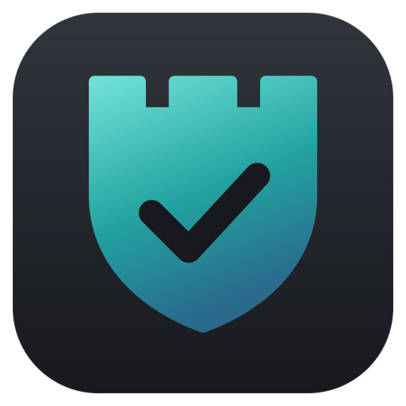
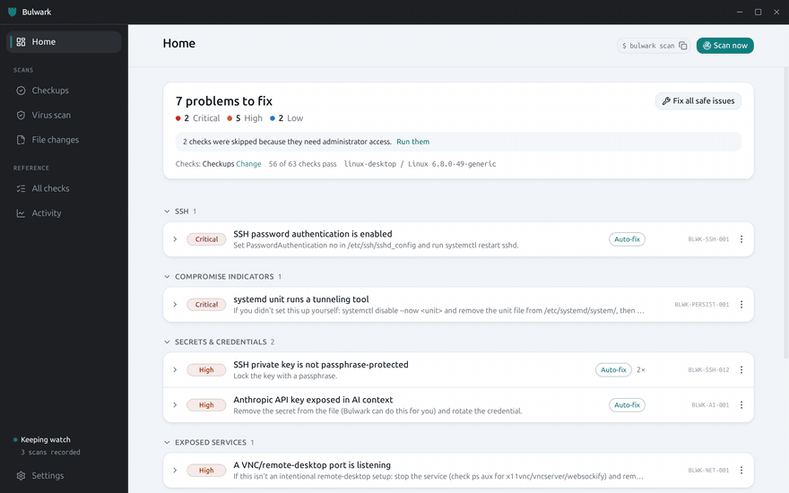
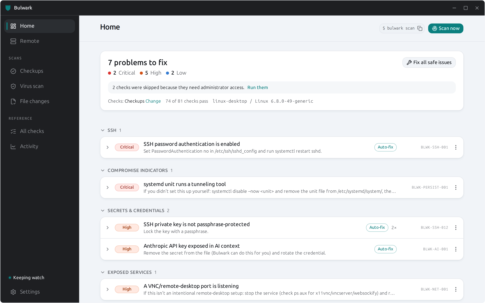
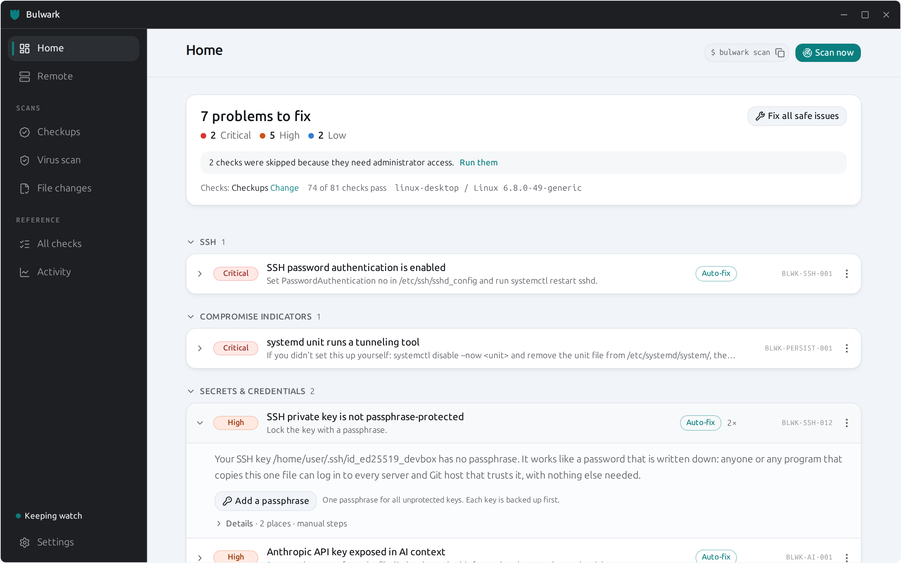
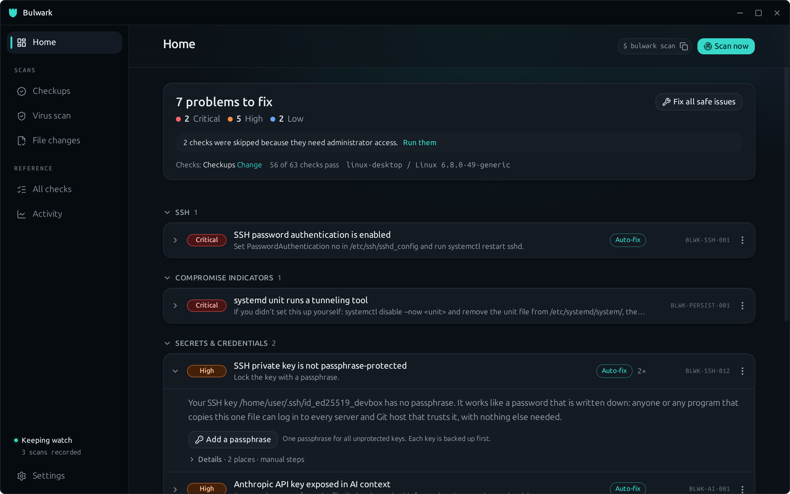
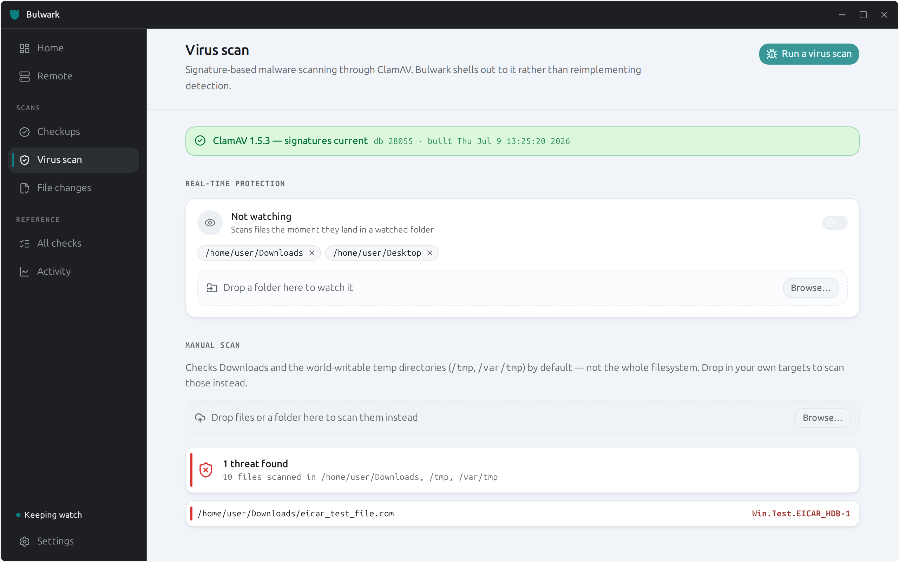
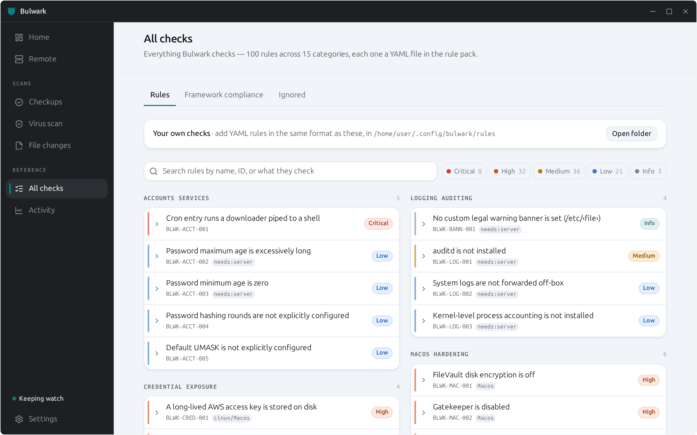
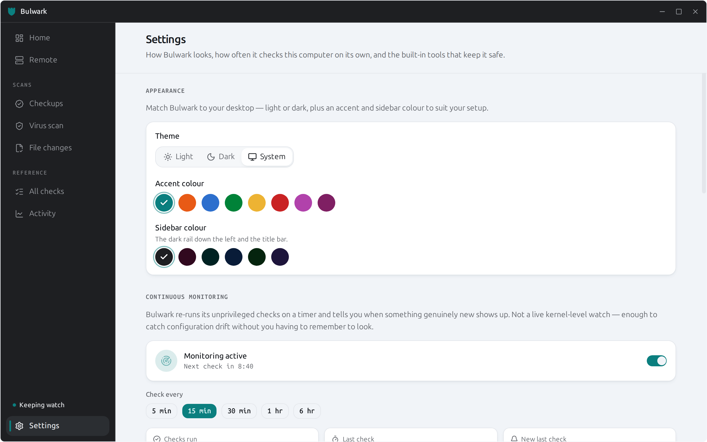

<p align="center">
  
</p>

<h1 align="center">Bulwark</h1>

<p align="center">
  <strong>Security scanner for Linux developer machines and servers.</strong><br>
  Plaintext keys, risky packages, exposed dev services and AI-assistant leaks, explained in plain language and fixed in one click.
</p>

<p align="center">
  <a href="https://github.com/vietanhdev/bulwark/actions/workflows/ci.yml"></a>
  <a href="LICENSE"></a>
  <a href="https://bulwark.nrl.ai"></a>
  <a href="https://bulwark.nrl.ai/checks/"></a>
</p>

Bulwark looks where attacks on developer machines start: long-lived cloud keys and Git or Docker
passwords stored in plain text, SSH keys without a passphrase, Python startup hooks and known
malicious-package traces, dev databases listening on every network interface, and API keys pasted
into **AI coding assistant** sessions and memory (Claude Code, Cursor, Copilot, Codex, Gemini and
more). It also checks SSH, sudo, kernel, persistence and file permissions, and scans for viruses
with ClamAV.

Problems are grouped by cause and ranked by severity. Each one says why it matters in a sentence
and offers the fix: one click when Bulwark can do it safely (previewed and backed up), numbered
steps with copyable commands otherwise. [Every check has its own page](https://bulwark.nrl.ai/checks/)
with the full explanation. It scans other machines over SSH too.

Built with Tauri v2 + Rust + React. One rule engine, one rule pack, two front-doors: the desktop
app and the CLI (`bulwark` when installed with the app, `bulwarkctl` from the CLI-only package).
Fully local — no telemetry, nothing leaves the machine.

## Demo



## Screenshots

| | |
|---|---|
|  |  |
| **Home** — problems grouped by cause, ranked by severity | **Fix** — why it matters, the one-click fix, then details |
|  |  |
| **Dark mode** — follows your desktop or set by hand | **Virus scan** — ClamAV with live progress and folder watching |
|  |  |
| **All checks** — every rule, searchable, with CIS / MITRE ATT&CK coverage | **Settings** — light or dark, eight accents, six sidebar colours |

## Features

- **73 rules** across 12 categories (credential exposure, SSH/remote access, persistence, network
  egress, kernel hardening, filesystem permissions, privilege escalation, logging/auditing,
  accounts/services, defense evasion, rootkit/malware, file integrity), each carrying a severity,
  a plain-language explanation with live values interpolated in, step-by-step fix, and CIS/MITRE
  ATT&CK references. Every check, including the 23 AI assistant checks, has its own page at
  [bulwark.nrl.ai/checks](https://bulwark.nrl.ai/checks/).
- **AI assistant security** — scans the AI coding assistants on the machine (Claude Code, Claude
  Desktop, Cursor, Copilot, Codex, Gemini, Qwen Code, Zed, Goose, OpenCode, Kilo Code, Crush, Amp,
  Kiro, Amazon Q, Cline, Roo, Windsurf / Devin Desktop, Continue, Augment, JetBrains Junie, Aider,
  Warp, Open Interpreter, and VS Code with its forks) for secrets leaked into
  context/memory/transcripts and for dangerous agent configuration a prompt injection could turn
  into code execution: project-supplied Claude Code hooks (CVE-2025-59536), VS Code
  auto-approve/"YOLO mode" (CVE-2025-53773), MCP servers on unpinned `npx` or vulnerable
  `mcp-remote` (CVE-2025-6514), hidden-Unicode "Rules File Backdoor" instruction files,
  base-URL exfil overrides, and world-readable credential stores. Workspaces are auto-discovered;
  leaked secrets are opt-in redactable (dry-run first, `0600` backup, permissions preserved). A
  highlighted tab in the GUI and `bulwarkctl ai scan` / `bulwarkctl ai redact` in the CLI.
- **Antivirus scanning** — shells out to a real ClamAV `clamscan` on demand, plus a fast
  presence/database-freshness check on every routine scan.
- **Log analysis** — a decode → detect → correlate pipeline over the systemd journal (or any
  syslog-format file) that catches *events over time* the config scanner can't see: SSH
  brute-force, invalid-user scans, sudo/su abuse, direct root logins. Decoders (YAML regex →
  fields) and rules (the same condition DSL as the config engine, plus a `correlate` block) are
  data, not code, and correlation uses keyed sliding windows — "8 failed logins from one IP in
  60s," not "a failed login." Run it with `bulwarkctl logs scan`.
- **Continuous monitoring** — a periodic re-scan loop (default 15 min) plus a filesystem watcher
  on the specific sensitive paths the rule pack actually reads (sshd_config, systemd units,
  sudoers, cron, `authorized_keys`), so an edit to one of those triggers an immediate re-check
  instead of waiting for the next tick. Findings are reconciled across runs so recurring issues
  don't duplicate, and genuinely new findings raise a desktop notification.
- **Compliance view** — every rule's CIS/MITRE ATT&CK references are cross-referenced against
  open findings to show pass/fail coverage per framework.
- **Two front-doors, one engine** — everything above is available identically from the CLI
  (scriptable, cron-friendly, JSON output) and the GUI (dashboard, live scan streaming, one-click
  privileged re-scan via polkit).
- **Extensible by design** — new checks are YAML files with a small condition DSL
  (`==`, `!=`, `in`, `contains`, `matches`, `<`/`>`/`<=`/`>=`, `and`/`or`/`not`), not Rust code.
  No plugin API to learn.

## How it compares

Bulwark fills a specific gap: a *desktop-native, continuously-monitoring* host scanner with a
real GUI — most established open-source Linux auditors are CLI-only, snapshot-style tools, and
most tools with a real-time/EDR story are commercial, cloud-connected, and built for fleets, not
a single desktop.

| Tool | Type | Scope | GUI | Continuous | Compliance mapping | Remediation |
|---|---|---|---|---|---|---|
| **Bulwark** | Open source | Host config audit + AV + basic rootkit indicators | ✅ native desktop | ✅ periodic + file-watch | ✅ CIS/ATT&CK per rule | Plain-language fix hint |
| [Lynis](https://github.com/cisofy/lynis) | Open source | Host config audit, ~300+ checks across boot, filesystem, network, auth, kernel[^1] | ❌ CLI-only[^1] | ❌ on-demand/cron only[^1] | Partial (HIPAA/ISO27001/PCI DSS via Enterprise)[^1] | Suggestions in report, no auto-fix |
| [rkhunter](https://rkhunter.sourceforge.net/) / [chkrootkit](https://github.com/Magentron/chkrootkit) | Open source | Rootkit/backdoor signature detection[^2] | ❌ CLI-only | ❌ on-demand/cron only | ❌ | Detection only, no remediation[^2] |
| AIDE | Open source | File-integrity monitoring (checksummed baseline vs. current state) | ❌ CLI-only | ❌ on-demand/cron only | ❌ | Detection only |
| [OpenSCAP](https://www.open-scap.org/) / CIS-CAT | Open source | Standardized compliance scanning (CIS, DISA STIG, PCI-DSS) against SCAP content[^3] | Partial (SCAP Workbench) | ❌ on-demand/cron only | ✅ Primary purpose[^3] | ✅ Ansible/Bash remediation scripts[^3] |
| [Wazuh](https://wazuh.com/) | Open source | Full XDR/SIEM: FIM, rootcheck, log analysis, SCA, ClamAV/YARA/VirusTotal integration[^4] | ✅ web dashboard (needs a manager+indexer stack) | ✅ real-time agent | ✅ built-in SCA | Active-response scripting |
| CrowdStrike Falcon | Commercial | Cloud-native EDR — IOA/behavioral analytics, threat hunting, vulnerability mgmt[^5] | ✅ cloud console | ✅ real-time, cloud-dependent | Enterprise add-ons | Automated response |
| SentinelOne Singularity | Commercial | Local AI-driven EPP+EDR, autonomous response, rollback[^5] | ✅ cloud console | ✅ real-time, works offline | Enterprise add-ons | Automated response + rollback |

**Where Bulwark sits**: closer to Lynis in scope (a single-host config auditor, not a fleet-wide
SIEM) but with the desktop-native GUI, continuous file-triggered re-checks, and antivirus
integration that Lynis intentionally doesn't provide[^1]. It doesn't attempt Wazuh's or the
commercial EDR platforms' real-time syscall/process telemetry — that's real-time *kernel-level*
monitoring (eBPF-class), which is a deliberate v1 non-goal (see the design doc, §2 and §13
Option C) rather than a gap nobody noticed. It also doesn't do AIDE-style cryptographic
file-integrity baselining or Wazuh/rkhunter-style rootkit signature databases beyond a small,
targeted set of persistence/rootkit indicator rules — those are natural, scoped directions for
the rule pack to grow into, not architectural blockers. The one place it now steps toward
Wazuh's territory is **log analysis**: `bulwarkctl logs scan` decodes and correlates journal/auth
events (SSH brute-force, sudo abuse, invalid-user scans) with a keyed sliding-window correlator —
OSSEC's decode→detect→correlate design without its dated XML/global-list internals. This ships as
a one-shot batch command today; continuous follow-mode is the next step (see the design doc).

[^1]: [Lynis on GitHub](https://github.com/cisofy/lynis) — CLI/agentless tool, plugin-extensible, HIPAA/ISO27001/PCI DSS compliance testing via CISOfy Enterprise.
[^2]: [Chkrootkit and rkhunter: rootkit detectors for Linux](https://www.fgfgo.com/chkrootkit-and-rkhunter-best-free-rootkit-detectors-for-linux-2026/) — signature/heuristic detection tools, not remediation tools; commonly run together for coverage.
[^3]: [Red Hat: CIS compliance in RHEL using OpenSCAP](https://www.redhat.com/en/blog/center-internet-security-cis-compliance-red-hat-enterprise-linux-using-openscap) — SCAP-standardized scanning with CIS/STIG/PCI-DSS profiles and Ansible/Bash-based automated remediation.
[^4]: [Wazuh platform overview](https://wazuh.com/platform/overview/) and [Wazuh malware detection](https://opennix.org/en/docs/wazuh/capabilities/wazuh-malware-detection/) — FIM (scheduled/real-time/who-data modes), rootcheck, ClamAV/YARA/VirusTotal-integrated malware detection, SCA compliance module.
[^5]: [SentinelOne vs. CrowdStrike](https://www.sentinelone.com/vs/crowdstrike/) and [CrowdStrike Falcon EDR](https://www.crowdstrike.com/en-us/compare/crowdstrike-vs-sentinelone/) — CrowdStrike is cloud-native/cloud-dependent for analytics; SentinelOne's agent runs detection locally and works offline.

## Quick start

```bash
# Core + CLI
cargo build --workspace
cargo run -p bulwarkctl -- scan

# Scan another machine over SSH (agentless: reuses your ~/.ssh config, keys, and agent).
# Prefers a bulwark installed on the remote; otherwise pushes the binary + rules and cleans up.
cargo run -p bulwarkctl -- scan --ssh user@host

# Apply safe, reversible autofixes for what a scan finds (dry-run by default; --apply to change).
cargo run -p bulwarkctl -- fix list            # preview every available fix
cargo run -p bulwarkctl -- fix ssh-perms --apply    # tighten ~/.ssh permissions
sudo   bulwarkctl               fix all --apply     # ~/.ssh + /etc perms + sshd hardening
cargo run -p bulwarkctl -- ssh protect         # one passphrase for every unencrypted key

# GUI (from apps/bulwark-app/)
npm install
cargo tauri dev
```

See [`AGENTS.md`](AGENTS.md) for the full command reference, and
[`docs/guide/architecture.md`](docs/guide/architecture.md)
for architecture, data model, and the alternatives considered before landing on this design.

## Adding a rule

Rules are YAML files under `rules/<category>/`, no Rust required:

```yaml
id: BLWK-SSH-004
title: SSH X11 forwarding is enabled
category: ssh-remote-access
severity: low
collector: sshd_config
condition: x11_forwarding == "yes"
explain: "X11Forwarding is set to \"{{ sshd.x11_forwarding }}\" in sshd_config..."
fix: "Set 'X11Forwarding no' in /etc/ssh/sshd_config and run 'systemctl restart sshd'."
references: [CIS-5.2.4]
```

See `AGENTS.md`'s "adding a new check" section for the full workflow, including the condition
grammar and testing expectations.

## License

Apache-2.0 — see [`LICENSE`](LICENSE). Contributions are accepted under those same terms, with no separate CLA, signature or bot required;
see [`CONTRIBUTING.md`](CONTRIBUTING.md).
