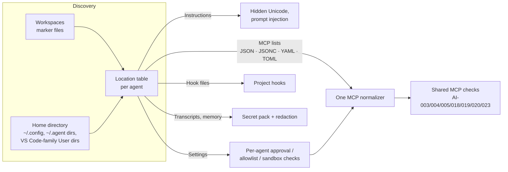

# Agent Security

Bulwark scans the AI coding assistants on your machine for three classes of problem that ordinary
host scanners don't look for. The [supported agents](#supported-agents) are Claude Code, Claude
Desktop, Cursor (editor and CLI), GitHub Copilot (VS Code and CLI), OpenAI Codex, Gemini CLI, Qwen
Code, Zed, Goose, OpenCode, Kilo Code, Crush, Amp, Kiro, Amazon Q, Cline, Roo, Windsurf / Devin
Desktop, Continue, Augment, JetBrains Junie and AI Assistant, Aider, Warp and Open Interpreter, plus
VS Code and its forks (VS Code Insiders, VSCodium, Cursor, Windsurf, Kiro).

1. **Secrets leaked into AI context.** API keys, tokens and connection strings pasted into an
   assistant's **session transcripts** or **memory** (for Claude Code, `~/.claude/projects/*/*.jsonl`
   and `~/.claude/projects/*/memory/*.md`). Transcripts keep a copy on disk long after the
   conversation. Project `.env` files and configs are deliberately *not* secret-scanned here:
   they are meant to hold secrets, and flagging them buried real leaks under false positives.
2. **Dangerous agent configuration.** Settings that a prompt injection can turn into code
   execution on your host, grounded in real, published attacks.
3. **Sandbox posture.** Whether the agent's own command sandbox is switched off, and whether the
   account the agents run as can become root without a password anyway.

In the desktop app these checks run as part of every **Scan now** and their problems appear on
Home with everything else (configure extra folders in **Settings → AI assistant checks**). From a
terminal, `bulwark ai scan` runs only these checks (`bulwarkctl ai scan` with the CLI-only
package). Each check below links to its own page with the full explanation and fix.


::: warning A scan reads real secrets. Treat its output accordingly.
Findings are stored and displayed with the secret **masked** (`sk-a…3f`), never in full, and the
raw value is never written to the database or the logs. But the *file paths* a finding points at
are real, so a screenshot of a live scan can still disclose where you keep things. The screenshots
in this documentation are deliberately generated from fixtures, not from a real machine.
:::

## What it checks

| Rule | Severity | What it catches | Reference |
|---|---|---|---|
| [`BLWK-AI-001`](/checks/blwk-ai-001) | High / Medium | A provider secret (Anthropic, OpenAI, GitHub, AWS, …) in an assistant's context, config, or transcript | T1552.001 |
| [`BLWK-AI-002`](/checks/blwk-ai-002) | Critical | Project-supplied agent **hooks** that run shell on session/tool events (Claude Code, Cursor, Kiro, Copilot, Gemini/Qwen, Crush, Augment, Cline, Devin Desktop) | [CVE-2025-59536](https://research.checkpoint.com/2026/rce-and-api-token-exfiltration-through-claude-code-project-files-cve-2025-59536/) |
| [`BLWK-AI-003`](/checks/blwk-ai-003) | High | An MCP server launched via an **unpinned** `npx`/`uvx` package | T1195.001 |
| [`BLWK-AI-004`](/checks/blwk-ai-004) | High | An MCP server using **`mcp-remote`** (command-injection ≤ 0.1.15) | [CVE-2025-6514](https://nvd.nist.gov/vuln/detail/CVE-2025-6514) |
| [`BLWK-AI-005`](/checks/blwk-ai-005) | High | An MCP server wrapped in a **shell interpreter** (`bash -c …`) | T1059.004 |
| [`BLWK-AI-006`](/checks/blwk-ai-006) | High | A permission allowlist that permits **arbitrary execution** (`Bash(*)`, `Shell(*)`, `run_shell_command`, a blanket `bash: allow`) | T1059 |
| [`BLWK-AI-007`](/checks/blwk-ai-007) | High | An agent told **never to ask** — `bypassPermissions`, Zed `default: allow`, Goose `GOOSE_MODE: auto`, OpenCode `permission: allow`, Qwen Code `yolo`, Cursor CLI `unrestricted`, Open Interpreter `auto_run` | T1059 |
| [`BLWK-AI-008`](/checks/blwk-ai-008) | High | `enableAllProjectMcpServers` / `enabledMcpjsonServers` auto-enabling a repo's MCP servers | CVE-2025-59536 |
| [`BLWK-AI-009`](/checks/blwk-ai-009) | Critical | VS Code `chat.tools.autoApprove` ("YOLO mode") | [CVE-2025-53773](https://www.wiz.io/vulnerability-database/cve/cve-2025-53773) |
| [`BLWK-AI-010`](/checks/blwk-ai-010) | High | VS Code Workspace Trust disabled | T1204.002 |
| [`BLWK-AI-011`](/checks/blwk-ai-011) | High | A VS Code task set to run on `folderOpen` | T1204.002 |
| [`BLWK-AI-012`](/checks/blwk-ai-012) | High | Hidden Unicode / bidi controls in an instruction file (the **Rules File Backdoor**) | [Pillar Security](https://www.pillar.security/blog/new-vulnerability-in-github-copilot-and-cursor-how-hackers-can-weaponize-code-agents) |
| [`BLWK-AI-013`](/checks/blwk-ai-013) | Medium | Prompt-injection-style phrases in an instruction file (heuristic) | T1566 |
| [`BLWK-AI-014`](/checks/blwk-ai-014) | High | An `ANTHROPIC_BASE_URL` / `OPENAI_BASE_URL` override to a non-official host | CVE-2025-59536 |
| [`BLWK-AI-015`](/checks/blwk-ai-015) | Medium | A plaintext credential file readable by group/other | T1552.001 |
| [`BLWK-AI-016`](/checks/blwk-ai-016) | High | A secret-bearing file in a git repo with no `.gitignore` rule covering it | T1552.001 |
| [`BLWK-AI-017`](/checks/blwk-ai-017) | High | Codex `approval_policy = "never"` + `sandbox_mode = "danger-full-access"` | T1059 |
| [`BLWK-AI-018`](/checks/blwk-ai-018) | High | An MCP server connecting to a **remote endpoint with a plaintext token** in its config | T1552.001, T1071.001 |
| [`BLWK-AI-019`](/checks/blwk-ai-019) | Critical | An MCP server running a **privileged or host-mounting container** (`--privileged`, `-v /var/run/docker.sock`, `-v /:…`) | T1610, T1611 |
| [`BLWK-AI-020`](/checks/blwk-ai-020) | High | A **filesystem MCP server granted an over-broad root** (`/` or your whole home directory) | T1083 |
| [`BLWK-AI-021`](/checks/blwk-ai-021) | High | An agent's **command sandbox is turned off** (Codex `danger-full-access`, Cursor CLI `sandbox.mode: disabled`, Claude Code's weaker nested sandbox) | T1059, T1611 |
| [`BLWK-AI-022`](/checks/blwk-ai-022) | High | The account that runs your agents is in the **`docker`, `lxd` or `incus-admin` group**, so it can become root with no password | T1611, T1068 |
| [`BLWK-AI-023`](/checks/blwk-ai-023) | Medium | An MCP server whose **tools all run without approval** (`trust: true`, `autoApprove: ["*"]`, `alwaysAllow: ["*"]`) | T1059 |

These are native Rust detectors, not YAML rules — the same reason the ClamAV integration isn't a
collector. Secret detection needs capturing regexes and redaction spans; the config checks parse
MCP JSON and inspect files for invisible Unicode; none of that fits the flat condition DSL. They
carry the same shape as a YAML rule all the same (id, severity, plain-language explanation,
one-line fix, references) and the same discipline (every detector is unit-tested, including a
benign no-false-positive case).

## Supported agents

Every agent stores the same few things in its own dialect: instruction files the model reads,
settings that decide what it may do without asking, hooks that run commands on agent events, MCP
server lists, and transcripts. Bulwark knows where each agent keeps them, normalizes the MCP server
lists into one shape, and runs one set of checks over all of them. A new agent mostly needs new
locations, not new rules.



| Agent | What Bulwark reads |
|---|---|
| Claude Code | `CLAUDE.md`, `CLAUDE.local.md`, `.claude/{settings,agents,commands,skills,rules}`, `.mcp.json`, `~/.claude.json`, installed plugins (`~/.claude/plugins/cache`), transcripts, memory, prompt history |
| Claude Desktop | `~/.config/Claude/claude_desktop_config.json` |
| Codex | `~/.codex/config.toml` (approvals, sandbox, `[mcp_servers]`), `AGENTS.md`, prompts, sessions, history |
| Cursor | `.cursorrules`, `.cursor/{rules,commands,mcp.json,hooks.json,cli.json}`, `~/.cursor/{mcp,cli-config}.json`, Cursor's VS Code-style user settings |
| GitHub Copilot | `.github/{copilot-instructions.md,instructions,prompts,agents,chatmodes,hooks,copilot/settings.json,mcp.json}`, `~/.copilot` (MCP, instructions, agents, `providers.json`) |
| Gemini CLI / Qwen Code | `GEMINI.md` / `QWEN.md`, `.gemini` / `.qwen` settings, commands, agents, skills and rules, extensions, chat transcripts, OAuth credential files |
| Zed | `.rules`, `.zed/settings.json`, `~/.config/zed/settings.json` (`agent.tool_permissions`, `context_servers`) |
| Goose | `.goosehints`, `~/.config/goose/config.yaml` (`GOOSE_MODE`, `extensions`), `secrets.yaml` |
| OpenCode / Kilo Code | `opencode.json[c]` / `kilo.json[c]` (`permission`, `mcp`), `.opencode` agents, commands and modes, `.kilo` rules |
| Crush | `CRUSH.md`, `crush.json`, project `crushrc` (a shell script Crush runs at startup) |
| Amp | `.amp/settings.json`, `~/.config/amp/settings.json` (`amp.mcpServers`) |
| Kiro / Amazon Q | `.kiro/{steering,agents,hooks,settings/mcp.json}`, `.amazonq/{rules,prompts,cli-agents,mcp.json}`, `~/.aws/amazonq` |
| Cline / Roo / Kilo (VS Code) | `.clinerules` (and its `hooks/`), `.roo`, `.roomodes`, `~/.cline/data` (MCP, task transcripts, `secrets.json`), the extensions' `globalStorage` in every VS Code-family editor |
| Windsurf / Devin Desktop | `.windsurfrules`, `.windsurf/rules`, `.devin/{rules,config.json,hooks.v1.json}`, `~/.codeium/windsurf/mcp_config.json` |
| Continue | `.continue/rules`, `.continue/mcpServers/*.yaml`, `~/.continue/config.yaml` |
| Augment, JetBrains, Warp | `.augment/{settings.json,rules}`, `.augment-guidelines`, `.junie`, `.aiassistant/rules`, `WARP.md` |
| Aider, Open Interpreter | `.aider.conf.yml` and chat history; `~/.config/open-interpreter/profiles/*.yaml` (`auto_run`) |
| Cross-agent | `AGENTS.md`, `AGENT.md`, `.agents/skills`, `~/.config/agents/skills` |
| VS Code and forks | `settings.json` (also per profile) and `mcp.json` under `~/.config/{Code,Code - Insiders,Code - OSS,VSCodium,Cursor,Windsurf,Kiro}/User` |

Only locations confirmed in an agent's own docs or source are listed. Zed, Goose, OpenCode, Crush and
Amazon Q keep their chat history in SQLite databases, which the text secret scanner can't read, so
those transcripts are not secret-scanned.

An MCP server switched off in its config (`disabled: true`, `enabled: false`) never launches, so
only its at-rest risk, an inline token, is reported for it.

**Hooks are reported only when a repository supplies them.** A hook in your own home directory is
your automation. A hook that arrives in a repository you cloned runs its authors' commands on your
machine (the CVE-2025-59536 pattern), whichever agent it targets. Your home folder is never treated as a cloned
repository, even when an agent was once run there.

## Sandbox posture

Approval prompts and sandboxes are the two things between a prompt-injected agent and your machine.
Bulwark reports an agent whose sandbox has been switched off (`BLWK-AI-021`) separately from one
that never asks (`BLWK-AI-007`). When both are true for Codex, that is the single stronger
`BLWK-AI-017`.

`BLWK-AI-022` looks past the agent's own settings. If the account your agents run as is in the
`docker`, `lxd` or `incus-admin` group, any shell command an agent runs can start a container that
mounts `/` and become root, sandbox or not. This check runs only on a whole-machine scan of your own
home directory, and only when at least one agent was found.

## How workspaces are discovered

Because every developer's layout differs, the scanned workspace set is derived, not hardcoded:

- **From your assistants' own records** — the projects Claude Code has opened (`~/.claude/projects/`).
- **A shallow sweep of common code roots** — `~/Workspaces`, `~/Projects`, `~/src`, `~/dev`,
  `~/code`, `~/git`, … — for directories carrying any supported agent's marker (`.claude/`,
  `CLAUDE.md`, `.cursor/`, `.mcp.json`, `AGENTS.md`, `.kiro/`, `opencode.json`, `.goosehints`,
  `.github/instructions/`, …). `node_modules`, `.git`, and build trees are skipped.
- **Roots you add** in the tab's settings, plus any you exclude.

Global `$HOME` tool state (`~/.claude/`, `~/.codex/`, `~/.gemini/`, `~/.config/<agent>/`, the
VS Code-family user directories, …) is always included. The desktop app also runs a periodic background sweep and notifies you when a
new secret or risky config appears — toggleable from the tab.

## Redaction

Bulwark **reads** these files but never rewrites them on its own — finding a secret and removing
it are two deliberate, separate acts, the same stance file-integrity baselining takes.

- **Dry run first.** `bulwarkctl ai redact` (no flags) reports exactly which files would change
  and how many secrets each holds, touching nothing.
- **Apply explicitly.** `bulwarkctl ai redact --apply` (or the tab's **Redact** button) rewrites
  the files, replacing each high-confidence secret with an inert placeholder. Before overwriting,
  it writes a `0600` backup of every file it touches, and it preserves the original file's
  permissions on the rewritten copy. Only high-confidence provider secrets are redacted — the
  fuzzy `KEY=value` heuristic is report-only.

Redaction removes the secret from disk; it can't un-leak it. **Rotate any exposed credential.**

## CLI

```bash
# Scan every discovered workspace + your home-directory tool state.
bulwarkctl ai scan

# Scan just one project (skips the whole-machine sweep).
bulwarkctl ai scan --target ~/work/service

# Add or exclude discovery roots.
bulwarkctl ai scan --root ~/oss --exclude ~/Projects/huge-monorepo

# Preview, then apply, redaction. A 0600 backup of each file is kept.
bulwarkctl ai redact
bulwarkctl ai redact --apply
```

`ai scan` exits non-zero on findings (`2` for a critical, `1` for medium/high), so it drops into
cron or CI the same way `bulwarkctl scan` does.

## Stopping a scan

A sweep across a machine with many workspaces takes a while, so every scan can be stopped from the
UI. Stop is not cosmetic: it stops the engine mid-walk (and, for the antivirus scan, **kills the
`clamscan` child process** rather than leaving it churning the disk in the background).

A stopped scan is **partial**, and Bulwark treats it that way rather than pretending otherwise:

- The results are labelled as partial and are **not persisted**. A half-finished sweep never
  replaces a complete picture on disk.
- Nothing it didn't reach is marked as passing. The rule engine only records the checks that
  demonstrably ran, so stopping a scan can never resolve a finding it never actually re-tested.
