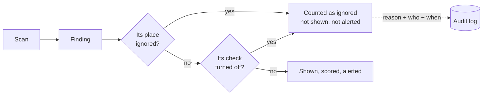

# Choosing what Bulwark checks

Every machine is different. A plain-HTTP registry may be your team's internal mirror; an SSH key
without a passphrase may live on a throw-away VM. Bulwark lets you say so — and keeps a record of
every such decision, because "why don't we see this anymore?" is a question someone will ask.



Nothing you hide stops the check running or deletes a finding: it is still checked every scan,
still counted ("4 accepted"), and comes straight back if you change your mind.

## Ignore one finding

When a check fires in several places and only one is fine — say BLWK-DEV-007 flags two config
files and one of them points at an internal mirror — ignore just that place:

- **In the app:** open the issue and choose **Ignore** next to that file, or **⋮ → Ignore only this
  one** when there is only one place. Give a reason; the rest keep being reported.
- **From a terminal:** `bulwarkctl rules suppress BLWK-DEV-007 --place /home/me/.npmrc --reason "internal mirror"`
  (or `bulwarkctl hosts ignore <machine> BLWK-DEV-007 --place … --reason …` for a monitored machine).

A place is the file, the listening port (`port 5432 on 0.0.0.0`), or — for a finding about the
machine as a whole — its title. Line numbers are left out on purpose, so an ignore survives the file
being edited.

## Ignore a type of issue, or turn a check off

- **⋮ → Ignore this type of issue** on any issue hides every finding of that check on that machine.
- **All checks** lists every check; open one and choose **Turn off** (with a reason) or **Turn on**.
  Checks you turned off show an *off* badge, and **All checks → Ignored** lists every decision,
  per-place ignores included, with the full history.
- Terminal: `bulwarkctl rules suppress <ID> --reason …` / `unsuppress`, and `bulwarkctl rules
  suppressions [--audit]`.

Each monitored machine keeps its own decisions: ignoring something on `web-1` never hides it on your
laptop.

**Choose the kind of machine.** Server-only checks (login banners, log forwarding, password ageing)
run only when you ask for them: **Checks → Change** on Home, or `bulwarkctl scan --needs server`.

## Add your own checks

Write a check in the same YAML format as Bulwark's own and drop it in your rules folder:

| System | Folder |
|---|---|
| Linux, macOS | `~/.config/bulwark/rules` (or `$XDG_CONFIG_HOME/bulwark/rules`) |
| Windows | `%APPDATA%\bulwark\rules` |

**All checks → Your own checks → Open folder** creates it with a commented example. A check reads the
facts one collector gathers and fires when its condition holds:

```yaml
id: MY-001                       # your own prefix; BLWK- is reserved
title: "Our registry must use HTTPS ({{ dev_tool_config.path }})"
category: developer-tools
severity: medium
collector: dev_tool_config       # which facts it reads
os: [linux, macos, windows]
condition: kind == "npm" and http_registry == true
explain: >
  {{ dev_tool_config.path }} installs packages from {{ dev_tool_config.detail }} over plain HTTP.
fix: "Point npm at https://registry.example.com instead."
references: []
```

The easiest start is an existing check: every [check page](/checks/) shows its rule, and
`bulwarkctl rules list` names them all. Conditions support `==` `!=` `in` `contains` `matches` (regex)
`<` `>` `<=` `>=` with `and`/`or`/`not`, one collector per check. Validate a folder with
`bulwarkctl rules validate ~/.config/bulwark/rules`.

Rules that keep custom checks honest:

- An id can't start with `BLWK-` or reuse a built-in id, so a custom check can never stand in for one
  of Bulwark's. A refused or broken file is listed under **Your own checks** with the reason — it is
  never silently skipped.
- Custom checks run on **this computer**, in the app's scans and background monitoring and in
  `bulwarkctl scan`. Monitored machines use their own installed checks.
- **Root scans don't load them.** The folder belongs to your account; a check planted there could
  copy root-only facts into a root scan's output. Pass `--custom-rules-dir` explicitly to
  `sudo bulwarkctl scan --privileged` if you really want them in a root scan; `--no-custom-rules`
  leaves them out of any scan.
