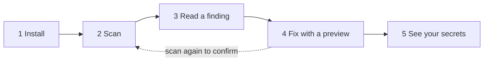

# Get started in five steps

Bulwark scans your dev machine for risky AI-agent settings, MCP servers, leaked keys, plain-text credentials and unsafe package-manager configs. This page takes you from install to a fixed problem in about ten minutes.



Screenshots on this page use sample data.

## 1. Install

Pick one:

- **Desktop app**: get the package for your system from [Download](/download), install it, and open **Bulwark**.
- **Command line only**: install `bulwarkctl` from the same page. Every step below has a command.

Bulwark needs no account and no setup. It works offline.

## 2. Run your first scan

Open the app. The first screen tells you what will happen. Choose **Start the first scan**.


The scan only reads. It checks, in a few seconds:

| What | Examples |
| --- | --- |
| AI coding agents | Agents allowed to run any command, hooks a cloned repository can trigger, MCP servers that auto-start, invisible text hidden in instruction files |
| Leaked keys | An API key pasted into an agent session or an instruction file |
| Stored credentials | A long-lived AWS key on disk, tokens in `~/.npmrc`, secrets exported from `~/.zshrc`, keys saved in your shell history |
| Developer tools | Git or npm with certificate checks off, npm running install scripts from any package, npm, bun or uv installing versions published minutes ago |
| The computer itself | SSH settings, exposed services, startup programs, file permissions |

From a terminal:

```bash
bulwarkctl scan        # this computer
bulwarkctl ai scan     # AI agents and keys in their files
```

## 3. Read a finding

Findings are grouped by what they protect, worst first. Open one to see **what is wrong**, **why it matters** and **how to fix it**.


Three things to know:

- **Critical** and **High** are worth fixing today. **Low** items are suggestions and sit folded at the bottom.
- A check that could not run (for example, one that needs your administrator password) is shown as **skipped**. It is never counted as passed. Choose **Run them** to finish those checks.
- Not relevant to you? Open the **⋮** menu on a finding to ignore that one place or turn the whole check off. Bulwark asks for a reason and keeps a record. See [Choosing what Bulwark checks](/guide/custom-checks).

## 4. Fix with a preview

Choose **Fix now**, next to **Scan now**. Bulwark lists every file and setting it would change. **Nothing is written yet.**


Read the list, then **Apply** or **Cancel**. Some fixes ask for your administrator password. When it finishes, Bulwark scans again so you can see the finding is gone.

Some problems cannot be fixed by a program, such as a leaked API key: you have to revoke it where it was issued. For those, the finding gives you the steps. Changes that could lock you out of a server (turning off SSH passwords, for example) are never applied in bulk; you review them one at a time.

From a terminal, every fix previews until you add `--apply`:

```bash
bulwarkctl fix list          # what can be fixed here
bulwarkctl fix all           # preview
bulwarkctl fix all --apply   # do it
```

`fix all` applies the changes that cannot surprise you: file permissions, SSH settings that
cannot lock you out, and kernel network settings. The login banner and password-ageing fixes
change wording and policy, so it lists them and you run them by name.

More in [Fixing findings](/guide/remediation).

## 5. See where your secrets live

Open **Secrets**. The first time, Bulwark adds a tab for each tool it finds on your computer: AWS, Docker, Git, GitHub CLI, npm, PyPI, Kubernetes and others. The **Inventory** tab puts them in one list.


Each row shows a name and **where it is stored**. Bulwark never reads, shows or copies the secret itself.

- **Keychain** or **Session**: good. The secret is protected by your system or expires on its own.
- **Plain text**: the secret sits in a readable file. Choose **Review in Scan** to see the finding and its fix.

More in [Secrets](/guide/secrets).

## Keep it that way

- **Check automatically.** In **Settings → Monitoring**, Bulwark re-runs its checks on a timer and tells you when something new appears.
- **Let your AI agent check itself.** `bulwarkctl agent install` teaches Claude Code, Codex, Cursor and others to run Bulwark when you ask "is this repo safe?". See [AI agents](/agents).
- **Check your servers.** Add a machine under **Tools → Remote hosts** to scan it over the SSH you already use. See [Monitoring other machines](/guide/remote-monitoring).
- **Check a pull request.** `bulwarkctl ai scan --target .` exits non-zero when it finds a problem, so it works in CI. See [the command line](/cli).
