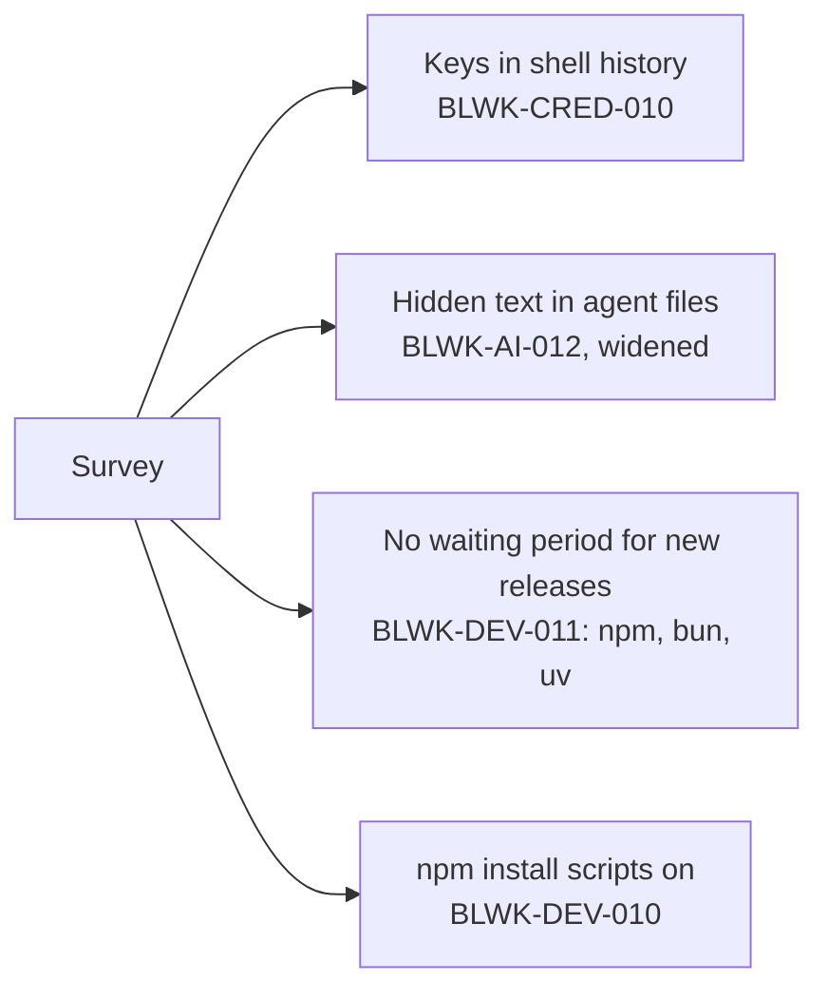

# What we learned from similar tools

Bulwark is not the only tool looking at developer machines. In November 2026 we compared it with the others, added the checks that were clearly worth having, and wrote down the rest. This page is that record.

## The tools we compared

| Tool | What it does well |
| --- | --- |
| [dev-machine-guard](https://github.com/step-security/dev-machine-guard) (StepSecurity) | Inventories AI agents, MCP servers, IDE and browser extensions, and audits package-manager settings |
| [Pareto Security](https://paretosecurity.com/security-checks) | A short list of pass/fail posture checks, including "package managers delay new releases" |
| [depsguard](https://github.com/arnica/depsguard) (Arnica) | Checks and fixes waiting-period and install-script settings across package managers |
| [Bagel](https://github.com/boostsecurityio/bagel) (Boost Security) | Finds credentials across developer tools, including shell history, and reports metadata only |
| [Snyk agent-scan](https://github.com/snyk/agent-scan), [Cisco mcp-scanner](https://github.com/cisco-ai-defense/mcp-scanner) | Inspect live MCP tool descriptions for poisoning, shadowing and hidden Unicode |
| [Aikido safe-chain](https://github.com/AikidoSec/safe-chain), [Socket sfw](https://github.com/SocketDev/sfw-free) | Block bad packages at install time through a proxy |

Two differences shape what Bulwark can borrow. It **runs nothing and calls nothing**: it reads files on your computer, so it cannot start an MCP server to read its tool descriptions, and it cannot sit between you and the registry. And it **explains and fixes**, where several of these tools only list.

## What Bulwark added

| Check | Learned from | What it catches |
| --- | --- | --- |
| [Keys saved in shell history](/checks/blwk-cred-010) | Bagel | A recognisable API key typed as part of a command and saved by bash, zsh, fish or PowerShell. Reports the service and line number, never the key. |
| [Hidden Unicode in instruction files](/checks/blwk-ai-012) | Snyk agent-scan | Besides bidirectional controls: invisible Unicode Tag characters (the finding shows the hidden text decoded) and long runs of zero-width characters. Flag emoji and ordinary emoji sequences are not flagged. |
| [No waiting period for new package versions](/checks/blwk-dev-011) | Pareto Security, depsguard | npm (`min-release-age`), bun (`minimumReleaseAge`) and uv (`exclude-newer`) installing versions published minutes ago. |
| [npm runs install scripts automatically](/checks/blwk-dev-010) | depsguard | `ignore-scripts` not turned on, the route the 2025–2026 npm worms used. |

Each setting name was confirmed in that tool's own reference before the check was written. A check keyed on a guessed name never fires and still looks like coverage.

## Left for later, on purpose

| Candidate | Why not yet |
| --- | --- |
| Waiting period for pnpm and yarn | Their defaults changed between versions, so "not set" does not reliably mean "off". Needs version detection first. |
| IDE and browser extension inventory | A good fit for the Secrets-style inventory page. A list of known-bad extensions goes stale without network access, so the first version would be an inventory only. |
| What a skill bundle contains | Scripts that download and run code, or fetch their instructions at run time. Needs a careful rule set to avoid flagging ordinary install scripts. |
| Git settings that run commands | `core.hooksPath`, `core.sshCommand` in the global config. Often deliberate, so it needs to show the target and stay low severity. |
| Editor extension update delay | Only an explicit "0" is clearly wrong, so it would rarely fire. |

## Out of scope

- **Blocking installs** or proxying the registry. Bulwark reads; it does not intercept.
- **Live MCP inspection** (starting servers to read their tool descriptions) and anything that sends your data to a service.
- **Reading, revealing or syncing secret values.** Secrets shows names and where they are stored, nothing more.
