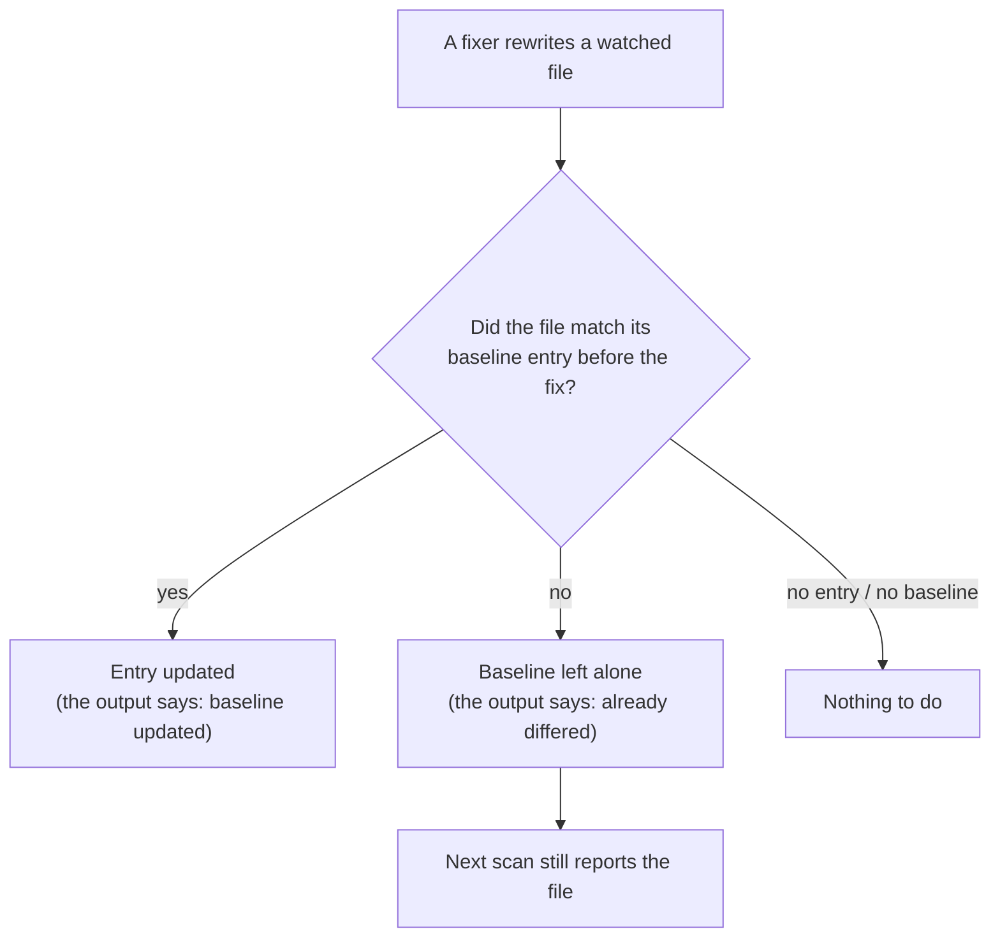
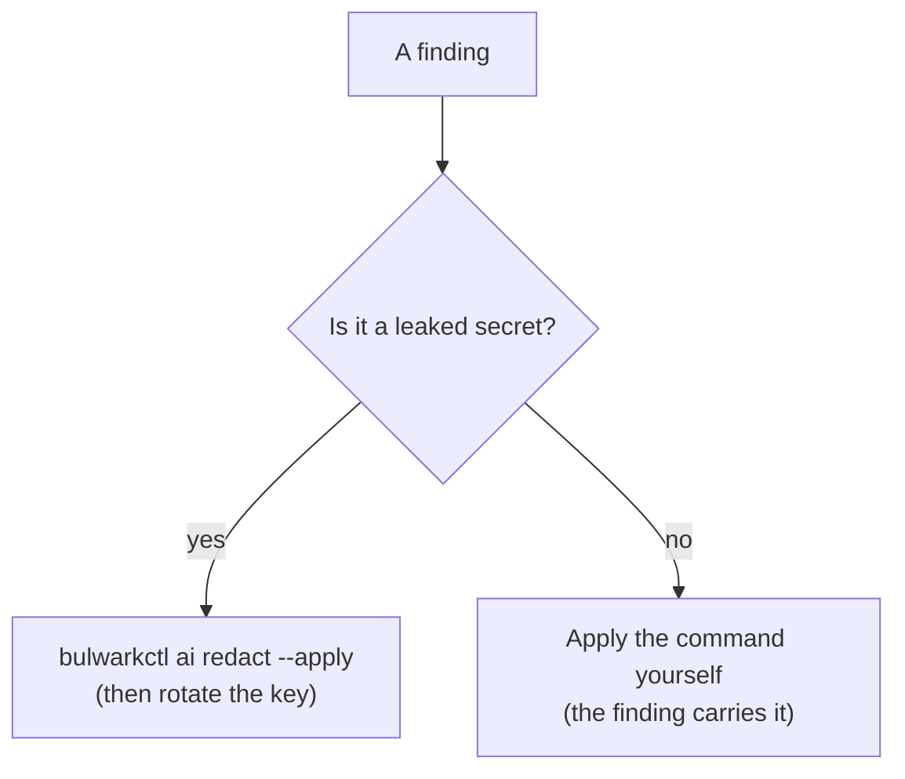

# Fixing what Bulwark finds

Bulwark fixes the problems that are **safe to fix automatically**, and hands you the exact command
for the ones that aren't. That split is the whole design: a scanner that edits your `sshd_config` or
`sudoers` and gets it wrong has locked you out of your own machine — a strictly worse outcome than
the finding it was trying to resolve. So fixes divide by blast radius. The reversible, low-risk ones
Bulwark automates — always **dry-run first**; file-writing fixers report backups and validation, while permission fixes report the modes they change. The genuinely dangerous ones it
shows you and gets out of the way.


## Fix now in Scan

**Fix now** sits beside **Scan now**. It is enabled
only when current evaluated findings have a supported non-lockout fix, and disabled
during scan/fix work. The first click prepares the existing host-wide safe-fix preview;
it never applies changes. Review every proposed path and setting, then choose Apply
or Cancel. Administrator access may be required even for preview. An error or
cancelled privilege request is not a successful preview.

The bulk set excludes SSH PasswordAuthentication and PermitRootLogin. Their
individual risk confirmations remain in the finding workflow. A profile/cache
reference in Secrets is not an eligible fix or proof of credential exposure.


## What Bulwark can fix for you

The `fix` command is the front door for the safe autofixes. Everything previews by default and only
changes anything with `--apply`:

```bash
bulwarkctl fix list                 # preview every available fix, changes nothing
bulwarkctl fix ssh-perms --apply    # tighten your own ~/.ssh (dir 700, keys/config 600), no sudo
sudo bulwarkctl fix all --apply     # the safe set: /etc permissions + sshd settings that cannot lock you out + kernel network settings
```

`fix all` applies only changes that cannot surprise you. Two fixes change wording or policy, so
`fix all` lists them and leaves them for you to run by name: `fix banner` and `fix login-defs`.

**Whose `~/.ssh`?** `fix ssh-perms` (and the `~/.ssh` part of `fix all`) works on the account it
runs as. Under `sudo` that is root, so `sudo bulwarkctl fix all --apply` tightens `/root/.ssh` and
says so; run `bulwarkctl fix ssh-perms --apply` without `sudo` for your own. Bulwark does not reach
into another account's home folder as root.

Each fixer is reversible and never widens access:

- **`fix ssh-perms`** tightens over-permissive files in `~/.ssh` (directory to `700`, private keys /
  `config` / `authorized_keys` to `600`, `known_hosts` and public keys to `644`). Those modes are
  the most a file may keep: access beyond them is removed, and none is ever added, so a
  `known_hosts` at `660` becomes `640`, not `644`. Never follows a symlink, and shows the mode
  before and after.
- **`fix etc-perms`** does the same for sensitive `/etc` files (`shadow` `640`, `sudoers` `440`,
  `sshd_config` `600`, `passwd` and `group` `644`): any file that grants more than its mode is
  tightened. That includes a stock `sshd_config` at `644`, which is readable by everyone and not
  only when it is writable. Needs root. With `sshd_config` at `600`, a scan without `sudo` can no
  longer read it, so its SSH checks run only under `sudo bulwarkctl scan --privileged`; the fixer
  says this when it makes the change.
- **`fix sshd`** hardens `/etc/ssh/sshd_config` to clear the SSH findings (X11/TCP forwarding off,
  `MaxAuthTries`, …) by inserting one managed block at the top of the file, backing up the file
  and validating with `sshd -t` before keeping it. The two directives that can lock you out —
  `PasswordAuthentication no` and `PermitRootLogin no` — are opt-in behind `--include-auth` and
  excluded from `fix all`.

  Running it again is safe. It plans against the settings sshd obeys now (drop-ins and the managed
  block included), so once a run has applied, the next one finds nothing to do and writes nothing.
  When there is something new to set, the block keeps every line it already has: a plain
  `fix sshd` or `fix all` never removes what an earlier `--include-auth` run set. Each run that
  changes the file first saves a copy under a new timestamped name in
  `~/.local/share/bulwark/sshd-config-backups/`, so the oldest file there is your original.
  Deleting the block (and the blank line after it) also restores it.

  One case it cannot fix: a directive set inside a `Match all` block. sshd applies that block
  after everything else, so a line at the top of the file does not win. `fix sshd` names the
  directive and leaves it for you to change in that block.

Three more fixers can be run by name. Each needs root to apply; `fix all` includes `fix sysctl` but not the other two, which change wording and policy:

- **`fix sysctl`** saves two kernel network settings in `/etc/sysctl.d/` (ICMP redirects off,
  martian logging on) and applies them to the running system. Each line of its output says what
  happened to that setting, and the command exits non-zero if one could not be applied. In a
  container the kernel belongs to the host, so the settings are saved but cannot take effect there.
- **`fix banner`** replaces `/etc/issue` and `/etc/issue.net` with a warning banner, but only
  where the file still holds the distribution's default text (getty's codes, or just the OS name
  and version). A banner someone wrote, or a file someone emptied, is reported and left exactly as
  it is. A symbolic link (Fedora ships `/etc/issue` as one) is replaced by a regular file; the file
  it pointed to is not changed. Not part of `fix all`.
- **`fix login-defs`** sets `PASS_MAX_DAYS 90` and `PASS_MIN_DAYS 1` in `/etc/login.defs` where
  the current value is outside the rule's threshold. A missing line or `-1` means "no limit" and
  is fixed too. Not part of `fix all`.
- **`ssh protect`** adds one passphrase to every unencrypted key in `~/.ssh` at once, backing each up
  first — far better than leaving plaintext keys on disk.

### Fixes and the file-integrity baseline

Some of these files are on the file-integrity watch list (`sshd_config`, `login.defs`). If you recorded a baseline with `bulwarkctl fim baseline`, a fixer that rewrites one
of them also brings that file's baseline entry up to date, so the next scan does not report
Bulwark's own edit as "modified since baseline":



The second branch is deliberate. A file that had already changed since the baseline was changed
by something other than this fix, and updating its entry would hide that. Look at the file, then
record a new baseline yourself.

In the desktop app these live in **Settings → SSH hardening** (tighten permissions, protect keys).

### Leaked secrets: redaction

Secret redaction is fully reversible in the same way: the secret is either there or it isn't, and
the original is always backed up.

```bash
# Preview — shows exactly which files and how many secrets. Changes nothing.
bulwarkctl ai redact

# Apply. Each file is backed up 0600 first, its permissions preserved, and every high-confidence
# secret replaced with an inert placeholder.
bulwarkctl ai redact --apply
```

In the desktop app this is the **Remove secret from this file** action on an expanded agent finding in Scan.

**Only the credential's own bytes are replaced.** Everything around it — the `KEY=` name, the quotes
around the value, the line ending that ends it — survives byte-for-byte, so a redacted file has
exactly as many lines as it started with. This matters more than it
sounds: the detection patterns match a *terminator* after the secret (usually the newline itself),
and a redactor that rewrote the whole matched span would delete it, welding the next line onto the
placeholder.

**The backup still holds the secret.** Each backup is the original file, key included, kept
`0600` in `~/.local/share/bulwark/redaction-backups` (a `0700` folder) with a small `.path` file
beside it naming the file it came from. Bulwark never deletes a backup. When you have checked the
result, delete the folder yourself:

```bash
rm -r ~/.local/share/bulwark/redaction-backups
```

Things it deliberately will *not* do:

- **It won't rewrite a file that something reads the key back from.** Only session transcripts,
  memory and instruction files inside an agent's own folder (`.claude`, `.codex`, `.cursor`, …) are
  rewritten. A `.env` is never touched, and a key found in a project's settings or MCP config file
  is reported but left in place: replacing it there would break whatever uses it. An instruction
  file at the root of a project (a bare `CLAUDE.md`, say) is also reported and left for you to edit.
- **It won't rotate the key for you.** Redaction removes the secret from that file; it cannot
  un-leak it. Anything that reached a transcript should be assumed compromised — go rotate it at
  the provider.
- **It won't touch a low-confidence (`generic-*`) match.** Those are reported but never rewritten,
  because blindly editing a value that merely *looked* like a secret could corrupt a real config.
- **It won't rewrite a file outside an agent's own folder, or through a link.** A `.env`, a
  `CLAUDE.md` at a project root, a file git ignores, and anything reached through a symbolic link
  are reported and left as they are. `ai redact` says how many such files hold a key.
- **It won't rewrite a file that is in use.** A file changed in the last 30 seconds is left alone,
  because the session that wrote it may still be writing; run it again when the session has
  ended, or add `--include-active`. A file that changes while it is being rewritten is left as it
  was.

`ai redact --apply` exits `1` when a file it meant to clean still holds a secret, and names the
file, so a script or an agent cannot take a refusal for success.

## What you should fix by hand

Everything below changes how an agent — or your shell, or SSH — behaves. A wrong edit is expensive,
so Bulwark shows you the command rather than running it. Each finding in a scan already carries its
own one-line fix; this is the same guidance, organised by category.

### Auto-execution on repo open (Critical)

These let a repository you merely *opened* run code before you reviewed it. Fix the repo, and be
wary of any repo you didn't author.

| Finding | Fix |
|---|---|
| `BLWK-AI-002` Claude Code hooks | Remove the `hooks` block from the repo's `.claude/settings.json`. Keep hooks only in your own trusted user-level settings. |
| `BLWK-AI-009` VS Code "YOLO mode" | Remove `"chat.tools.autoApprove": true` from `settings.json`. |
| `BLWK-AI-011` auto-run task | Remove `runOn: "folderOpen"`, or set `"task.allowAutomaticTasks": "off"`. |
| `BLWK-AI-010` Workspace Trust off | Set `"security.workspace.trust.enabled": true`. |
| `BLWK-AI-008` auto-enable MCP | Remove `enableAllProjectMcpServers` / `enabledMcpjsonServers` from committed settings. |

### MCP servers — third-party code with your permissions (High)

An MCP server is a program running as you. Treat it like one.

| Finding | Fix |
|---|---|
| `BLWK-AI-003` unpinned package | Pin to an exact version (`@scope/pkg@1.2.3`, not `-y latest`) and vet the publisher. |
| `BLWK-AI-004` vulnerable `mcp-remote` | Upgrade `mcp-remote` to ≥ 0.1.16 and pin it ([CVE-2025-6514](https://nvd.nist.gov/vuln/detail/CVE-2025-6514)). |
| `BLWK-AI-005` shell-wrapped server | Replace `bash -c`/`sh -c` with a direct executable + args. |

### Over-broad permissions (High)

| Finding | Fix |
|---|---|
| `BLWK-AI-006` wildcard allowlist | Scope it: replace `Bash(*)` / `Bash(curl:*)` / a bare `"*"` with the specific, read-only commands the agent actually needs. |
| `BLWK-AI-007` bypass mode | Remove `defaultMode: "bypassPermissions"`, and don't run with `--dangerously-skip-permissions` outside a throwaway container. |
| `BLWK-AI-017` Codex danger config | In `~/.codex/config.toml`, move `approval_policy` away from `"never"` **or** `sandbox_mode` away from `"danger-full-access"`. |

### Exfiltration and injection surface (High → Medium)

| Finding | Fix |
|---|---|
| `BLWK-AI-014` base-URL override | Remove the `ANTHROPIC_BASE_URL` / `OPENAI_BASE_URL` override unless it points at a proxy you trust — pointed at an attacker host it ships your API key in the auth header. |
| `BLWK-AI-012` hidden Unicode | Delete the hidden characters from the instruction file (bidirectional controls, invisible Tag characters, or long runs of zero-width characters; the finding shows any hidden text decoded). They're invisible to you and read by the model (the ["Rules File Backdoor"](https://www.pillar.security/blog/new-vulnerability-in-github-copilot-and-cursor-how-hackers-can-weaponize-code-agents)). |
| `BLWK-AI-013` injection phrases | Read the flagged line. This is a low-confidence heuristic — confirm before trusting the file. |

### Secret hygiene (High → Medium)

The secrets themselves are redactable (above); these are about their blast radius.

| Finding | Fix |
|---|---|
| `BLWK-AI-016` unignored in git | `echo '<file>' >> .gitignore`, then `git rm --cached <file>` if it was already committed, and rotate the credential. |
| `BLWK-AI-015` world-readable creds | `chmod 600 <file>`. |

## The one-line version



Redact secrets with Bulwark; rotate them at the provider. Everything else, apply the command the
finding gives you — by hand, because the cost of getting it wrong is yours, not the scanner's.
