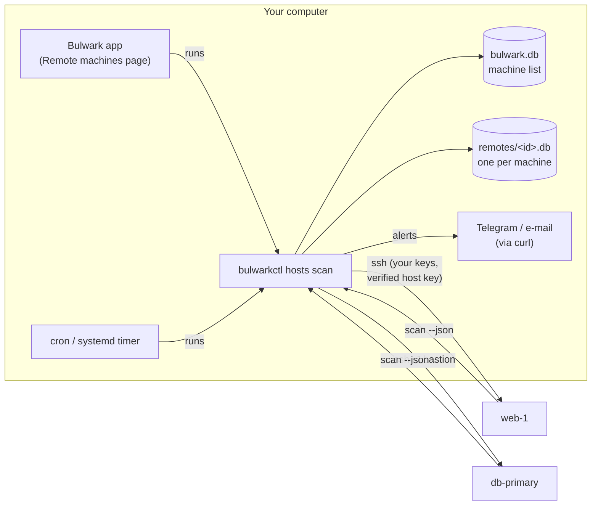
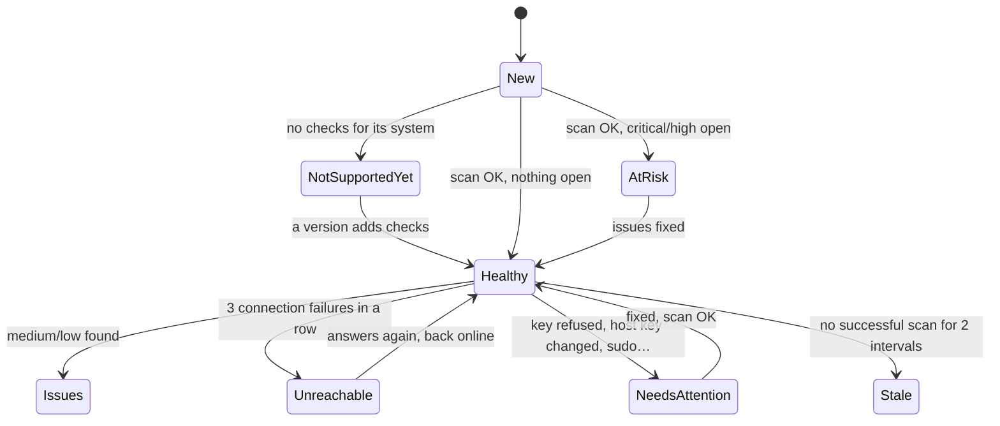

# Monitoring other machines

Bulwark can keep watch over your servers, home-lab boxes and other workstations, not only the
computer it runs on — Linux, macOS or Windows. It does this **without an agent**: on a schedule, it
opens an SSH connection with your own access, runs its checks there, brings the results home and
leaves. Between scans nothing of Bulwark runs on, or listens on, a monitored machine. A Linux
server needs nothing installed at all; a Mac or a Windows PC needs Bulwark installed, which runs only
when a scan asks for it.


That is a deliberate choice, and it is what makes Bulwark different from fleet tools such as Wazuh:

| | Bulwark | Agent-based fleet tools (e.g. Wazuh) |
|---|---|---|
| On each monitored machine | an SSH login, then gone (on a Mac or Windows PC, an installed Bulwark that only runs during a scan) | a resident agent |
| Central infrastructure | none — the desktop app or one cron line | a manager server, an indexer, a dashboard |
| Network exposure | your existing SSH; no new port | agent ↔ manager channel |
| Who it's for | a developer or small team with a handful to a few dozen machines | a security team running hundreds or thousands |
| Results | plain-language explanation and the fix, per issue | alerts for an analyst to triage |
| Where findings live | on your computer only | on the manager |

What Bulwark deliberately does **not** do: real-time kernel telemetry, log shipping and correlation
(SIEM), automatic response, or thousands of hosts. If you need those, you need an agent-based
platform; if you have a few machines and want to know what's wrong with them and how to fix it,
Bulwark is the lighter tool.


## How it works



- The SSH transport is the **system `ssh`**, so your `~/.ssh/config` (aliases, ports, keys, jump
  hosts, ProxyCommand) and your SSH agent work as-is.
- If Bulwark is installed on the machine, that copy runs. If not, Bulwark copies itself and its
  rules into a private `mktemp -d` directory, runs, and deletes it — after checking the machine's
  CPU architecture can run it.
- Each machine's findings are kept in **its own database** on your computer. They never mix with
  this computer's results, and a scan of one machine can never mark another's issues as fixed.
- The desktop app and the CLI share one machine list, so you can set things up in either.

## Which systems can be monitored

Support for other operating systems is added gradually, and a machine is never shown as "clean" just
because Bulwark had nothing to check there.

| System | Status | How |
|---|---|---|
| **Linux** (any distribution) | Full rule pack | Bulwark copies itself over for each scan, or uses an installed `bulwarkctl`. |
| **macOS** | Growing: FileVault, Gatekeeper, System Integrity Protection, firewall, automatic security updates, guest account ([BLWK-MAC-001…006](/checks/)), LaunchAgent/LaunchDaemon persistence ([BLWK-PERSIST-003](/checks/blwk-persist-003)), and the plaintext-credential and SSH-key checks | Install Bulwark on the Mac — the app in `/Applications` is enough, or `bulwarkctl` (see below). A Linux build can't run there. |
| **WSL** (Linux on Windows) | The Linux rule pack, minus checks about things the Windows host owns — the WSL kernel (MAC framework, module blacklists, SysRq, kexec), its network stack (ICMP redirects, martians), auditd and console banners — which are reported as *not applicable*, never as passing | Add the WSL distribution's SSH address, usually with the Windows host as the jump host. |
| **Windows** (native) | Defender, firewall profiles, BitLocker, UAC, Remote Desktop, SMBv1, the Guest account, automatic sign-in, Windows Update age ([BLWK-WIN-001…010](/checks/)) | Turn on Windows' OpenSSH Server and install Bulwark for Windows on the machine (see below). For the Linux side of the same PC, add its WSL as well. |

Bulwark recognises the system each time it connects and shows it on the machine's card — an
Ubuntu, Debian, Fedora, Arch, macOS, Windows or WSL tile, or a plain Linux one for other
distributions — so a mixed fleet reads at a glance. A machine shows a generic server tile until its
first successful connection.

Every machine shows **how many checks its last scan ran**, so "Healthy" on a Mac (about a dozen
checks) doesn't read like "Healthy" on a Linux server (sixty-odd). A machine whose system has no checks yet — a shell
Bulwark doesn't recognise, or a system where nothing applies — shows **Not supported yet**: grey,
never an alert, and re-checked once a day, so it starts scanning as soon as a Bulwark version adds
support for it.

**Installing on a Mac.** The Bulwark app in `/Applications` is enough: its scanner is used directly.
Otherwise Bulwark finds `bulwarkctl` in `/usr/local/bin`, `/opt/homebrew/bin`, `~/.local/bin` or
`~/.cargo/bin` (a non-interactive SSH session doesn't see your shell's `PATH`). With Rust
installed, a per-user install needs no `sudo`:

```bash
# on the Mac, from a checkout of the Bulwark source
cargo build --release -p bulwarkctl
install -m 0755 target/release/bulwarkctl ~/.local/bin/bulwarkctl   # every check is built in
```

Root-only daemon plists (`/Library/LaunchDaemons/*.plist` with mode `0600`) are read only with root
checks on; without them they are noted as unreadable, not flagged.

**Monitoring a Windows machine.** Two things on that PC:

1. **OpenSSH Server.** Settings → System → Optional features → *OpenSSH Server*, then start the
   *OpenSSH SSH Server* service (or, in an administrator PowerShell,
   `Add-WindowsCapability -Online -Name OpenSSH.Server~~~~0.0.1.0; Start-Service sshd;
   Set-Service sshd -StartupType Automatic`).
2. **Bulwark for Windows** from the [download page](/download). The desktop app includes the
   scanner; Bulwark looks for it where the installer puts it (`%LOCALAPPDATA%\bulwark`, or
   `Program Files\bulwark` for an all-users install) and on the `PATH`.

Bulwark talks to it through PowerShell, so it works whether the SSH server's default shell is cmd
or PowerShell. Two differences from Linux and macOS: **root checks** aren't available over SSH on
Windows yet — settings that need administrator rights (BitLocker, for one) are reported as unknown,
never as passing — and **Set up key access** can't install a key on Windows yet. Add a key yourself:
for an administrator account the public key goes in `C:\ProgramData\ssh\administrators_authorized_keys`,
otherwise in `%USERPROFILE%\.ssh\authorized_keys` on that PC.

## Adding a machine

**In the app:** **Remote** in the sidebar → **Add machine**. Enter `user@host`, an IP address, or pick a Host alias
from your `~/.ssh/config`. Bulwark then walks through the connection:

1. **Trust its identity.** The first time, Bulwark shows the machine's host key fingerprint and the
   command to print the same fingerprint on the machine itself. Compare, then approve. Approved keys
   are stored in Bulwark's own `known_hosts`; your `~/.ssh/known_hosts` is never modified.
2. **Key access.** If the machine doesn't accept your key, choose between:
   - **Set up key access** *(recommended)* — sign in once with your password; Bulwark creates its
     own monitoring key and installs it with the `restrict` option. The password is used for that
     one sign-in and never stored.
   - **Use a key you already have** — pick it, or load it into your agent with `ssh-add`.
3. **Schedule.** Every 15 minutes, hour, 6 hours or day. Bulwark scans immediately, then on that
   schedule while the app is running.

**From a terminal:**

```bash
bulwarkctl hosts add deploy@web-1.example.com --name web-1
bulwarkctl hosts test web-1          # step-by-step check, with the fix for whatever fails
bulwarkctl hosts trust web-1 --fingerprint SHA256:…   # after comparing on the machine
bulwarkctl hosts setup-key web-1 --password-stdin     # optional: dedicated restricted key
bulwarkctl hosts scan web-1
bulwarkctl hosts list
bulwarkctl hosts show web-1          # its open issues
```

Other options: `--port`, `--identity ~/.ssh/key`, `--jump me@bastion` (ProxyJump), `--privileged`
(root-only checks, see below), `--interval <minutes>`. Change any of them later with
`bulwarkctl hosts set web-1 …`; pause with `--enabled false`.

Open a machine to see its **connection** and its **last scan** side by side — a machine can answer
and still have a failed scan, or be offline with a recent scan's results still worth reading — and
its issues grouped by cause, the same way Home groups this computer's. Fixes run on that machine,
so each issue carries the command to run there, and the page shows the `ssh` command to open a
session.


### Monitoring from a Mac or a Windows computer

The app and `bulwarkctl` on macOS and Windows monitor machines the same way, through the `ssh`
those systems already ship (Windows 10 and 11 include OpenSSH). One difference: a Linux computer
can copy its own scanner to a Linux machine with the same processor for each scan, but a Mac or
Windows build can't run on Linux — so from a Mac or Windows computer, **install Bulwark on each
machine you monitor** (on Ubuntu, `sudo add-apt-repository ppa:vietanhng/bulwark && sudo apt install
bulwarkctl`). **Check connection** says so in its *Scanner on the machine* step, with the install
command, before any scan is attempted. The same applies to monitoring a Mac from Linux: install
`bulwarkctl` on the Mac (see above).

## Connection security

Bulwark is flexible about *how* you connect and strict about *whom* it connects to. Every check
under **Connection → Connection security** says how a setup compares with good practice, with the
safer option one click (or one command) away.

| Always enforced | Why |
|---|---|
| **Host keys are verified.** Unknown keys are never accepted automatically; a *changed* key stops scans and raises an alert. | A changed key is what an intercepted connection looks like. It is also what a reinstall looks like — only a person can tell which. After confirming a reinstall, replace the stored key (Connection → *Replace the stored key*, or `hosts trust … --replace`). |
| **No prompts in the background.** Scheduled scans run with `BatchMode=yes` and hard timeouts. | A scan can never hang on a password or passphrase prompt nobody will answer. |
| **No credentials offered to an unverified machine.** Reading a host key for approval turns every authentication method off. | Not even a public key is shown to a machine before you've confirmed it. |
| **Addresses can't be ssh options.** An address, key path or jump host starting with `-` is refused, and free-form `-o` options can't be stored. | Options such as `ProxyCommand` run local commands; a background scheduler must never replay one. Put advanced settings in `~/.ssh/config` and use its alias. |
| **A machine is recognised by its hostname.** If an address later answers as a different machine, its scan is refused and kept out of the history. | A moved DHCP lease or repointed DNS record must not merge two machines' results. Accept a deliberate rename with *Accept new identity* (`hosts set … --accept-identity`). |

| Recommended | How |
|---|---|
| **A dedicated, restricted key** | *Set up key access* / `hosts setup-key`. The key is installed as `restrict ssh-ed25519 …`: it can run commands, but not forward ports, reach your agent, or open a terminal. Revoke it by deleting that one line from the machine's `authorized_keys`. |
| **A regular account, not root** | Bulwark warns when it signs in as root. |
| **sudo limited to the scanner** for root-only checks | With Bulwark installed on the machine: `<user> ALL=(root) NOPASSWD: /usr/bin/bulwarkctl scan --json --no-persist --privileged` in `/etc/sudoers.d/bulwark` — exactly that command, never `scan *`, which would also allow options that run other commands as root. |
| **Bulwark installed on the machine** | Faster scans, updated with the system, and the only way to scope sudo to the scanner. |

### Root-only checks

Some checks (sudoers, shadow-file permissions, the firewall) need root. Turn **Include checks that
need root** on for a machine and Bulwark runs its scan through `sudo -n` there. Unlike on your own
computer — where root checks need a password prompt — this can run unattended, but only when sudo
on that machine doesn't ask for a password. The connection check tells you whether it does.

## Scheduling, and what each state means



- **A machine Bulwark couldn't reach is never shown as clean.** Its last results stay visible,
  marked as out of date.
- A machine that stops answering is retried **less often** — the interval doubles per failure, up
  to 6 hours — so a switched-off laptop doesn't cost a connection attempt every few minutes.
  Failures that need a person (a refused key, a changed host key) are not backed off.
- At most three machines are scanned at once, and never the same machine twice at a time.

### Without the app: cron or a systemd timer

```bash
# every 5 minutes, scan whichever machines are due; print only what's new or failing
*/5 * * * *  bulwarkctl hosts scan --due --quiet
# a daily summary to Telegram / e-mail
0 8 * * *    bulwarkctl notify report
```

Exit codes: `0` clean, `1` medium/high issues open, `2` critical issues open, `3` at least one
machine couldn't be scanned.

## Alerts on Telegram or by e-mail

Settings → **Alerts** (or `bulwarkctl notify …`). Nothing is sent until you set it up. Alerts carry
machine names, severities and issue titles — never file contents or secrets — and pass through
Telegram's or your mail provider's servers.

| Alert | When |
|---|---|
| New issues | A scan opened issues at or above your chosen severity (default: medium). |
| Identity / host key changed | Immediately, once. |
| Unreachable | After the third failed attempt in a row — not on every blip. |
| Back online | When an unreachable machine answers again. |
| Needs attention | Once, when a failure that needs a person starts. |
| Daily summary | Optional: every machine's state, once a day. |

Several alerts from one round of scans arrive as **one** message.

**Telegram:** create a bot with [@BotFather](https://t.me/BotFather) (`/newbot`), paste its token,
send the bot any message, then choose *Find my chat*. From a terminal:

```bash
bulwarkctl notify telegram          # prompts for the token, finds your chat
bulwarkctl notify test
```

**E-mail:** any SMTP server. `smtps://` (TLS) or `smtp://…:587` (STARTTLS, required — Bulwark never
falls back to sending in the clear); unencrypted delivery is allowed only to a relay on the same
computer (`smtp://localhost`). For Gmail and similar, use an app password.

```bash
bulwarkctl notify email --smtp-url smtps://smtp.example.com:465 \
  --from bulwark@example.com --to you@example.com --username bulwark@example.com
```

How secrets are kept: the bot token and SMTP password live in `notify-secrets.json` (mode `0600`)
next to the database — not in the database itself, so sharing or backing up the database never
leaks them. They reach `curl` through its standard input, never its command line, so they don't
show up in `ps`.

## When something goes wrong

Every failure comes with a plain-language reason and the next step; these are the common ones.

| You see | What to do |
|---|---|
| This machine hasn't been trusted yet | Compare and approve its fingerprint (Connection tab). |
| The machine's identity key has changed | Confirm with whoever manages the machine whether it was reinstalled. Only then replace the stored key. If it wasn't reinstalled, don't connect. |
| The machine didn't accept your SSH key | *Set up key access* with a password once, or load your key with `ssh-add`. With many keys in your agent, choose the right key file — Bulwark then offers only that one. |
| Root checks need passwordless sudo | Add the scoped sudoers rule shown in the connection check, or turn root checks off. |
| Bulwark can't run on this machine's processor | Install Bulwark on the machine; an installed copy always runs natively. |
| This address now belongs to a different machine | Check where the address points. If the machine was renamed on purpose, *Accept new identity*. |
| Bulwark can't scan this operating system yet | It's a Windows SSH shell. Monitor the machine's WSL instead (see *Which systems can be monitored*). |
| No checks for this system yet | The scan ran, but nothing applies there yet. Nothing to fix; Bulwark checks back daily. |
| The machine isn't answering | Bulwark keeps retrying, less often. Check the machine is on and reachable. |

### Inside the Flatpak

The Flatpak can monitor machines through the host's `ssh` (it uses the same host-command bridge as
its privileged scans), but it **can't copy itself** to a machine that doesn't have Bulwark: install
`bulwarkctl` there instead. The `.deb`, `.rpm` and AppImage have no such limit.
