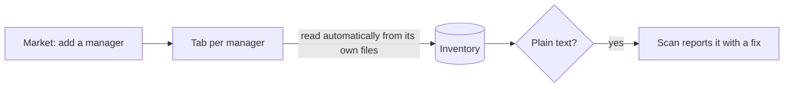

# Secrets — a manager for your secrets managers

Developer credentials live in many places: AWS profiles, Docker registry logins, Git credential helpers, the GitHub CLI. **Secrets** puts them in one view. Add the tools you use, and each becomes a tab that lists what it stores and *where* — in your keychain, behind a helper, as a short-lived session, or in plain text.

Secrets is an inventory, not a checker. Whether a credential is stored safely is judged in **Scan**, which reports problems such as a long-lived AWS key on disk or a token exported from `~/.zshrc`, each with a fix. Secrets shows names and storage only; it never reads, reveals, edits or exports a value.

## Add the managers you use

The first time you open Secrets, every manager whose files are found on this computer is added for you and read straight away (detection is a file-existence check). After that, your choice is kept: open **Secrets → Add** to add more, or remove a tab — removing every tab is remembered too, and nothing is added back behind your back. Each card says what its tab will show and whether the tool's files were found here. **Add** creates the tab; it installs nothing.

 Bulwark never downloads or installs third-party software: when a tool is missing, its tab shows the command to run in your own terminal.

| Manager | What its tab lists | Read from |
| --- | --- | --- |
| **AWS CLI** | Each profile's type — IAM Identity Center session, assumed role (with or without MFA), `credential_process` helper, or a static access key — and sign-in expiry | `~/.aws/config`, `~/.aws/credentials`, `~/.aws/sso/cache` (expiry only) |
| **Docker** | Registries, and whether each login sits in a credential helper or inline in `config.json` | `~/.docker/config.json` |
| **Git** | Credential helpers per host, and hosts with passwords saved in `~/.git-credentials` (host names only) | `~/.gitconfig`, `~/.config/git/config`, `~/.git-credentials` |
| **GitHub CLI** | Signed-in hosts and accounts, and whether each token is in the keychain or the file | `hosts.yml` (`~/.config/gh`, or `%APPDATA%\GitHub CLI` on Windows) |
| **npm** | Registry logins, and whether each token is written in the file or taken from an environment variable (`${NPM_TOKEN}`) | `~/.npmrc` |
| **PyPI** | Package indexes, and whether a password is stored or left to your keyring | `~/.pypirc` |
| **Kubernetes** | Kubeconfig users: exec plugin (and which), a key in a separate file, or a credential embedded in the file | `~/.kube/config` |
| **Tool tokens** | Which of GitHub CLI, Cargo, Terraform, RubyGems, Composer and netrc keep a login token in a file, and how many — the same files Scan's CRED-009 checks, read by the same parser | Each tool's token file under your home folder |

## The inventory

The **Inventory** tab combines every added manager into one table: name, manager, where it is stored, and details such as expiry. File-based managers are read automatically — every time you open Secrets, and whenever you add one — so the inventory reflects files changed in the meantime; the previous result stays on screen while it refreshes. They only parse the tool's own files, run nothing, and skip past values.

| Stored | Meaning |
| --- | --- |
| Keychain | Held by the OS keychain or a credential helper backed by one. |
| Session | A short-lived token the tool cached; **Expired** once its time has passed. |
| Helper | Fetched by an external program; where it keeps the secret is up to that program. |
| In memory | Git's `cache` helper: kept in memory for a while. |
| From environment | The file only references a variable such as `${NPM_TOKEN}`; the value lives elsewhere. |
| Plain text | Written out in a readable file. Scan reports these with a fix; **Review in Scan** takes you there. |
| No secret | Configuration only, such as an assumed role or a plain profile. |

Organisation-identifying values are used for matching only — an SSO start URL links a profile to its cache entry and is never displayed. A missing tool shows "not found" with setup steps, never an empty, healthy-looking list.

## What Secrets never does

No value is read into the app, displayed, copied or exported. Nothing signs you in, unlocks a vault, syncs, or revokes a credential. Rotation and provider administration stay in your own tools.
